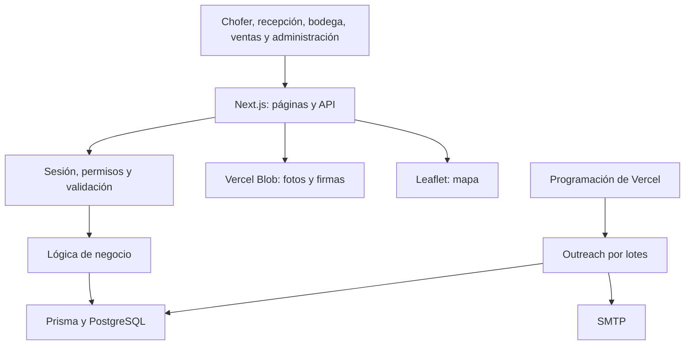

# Central Coopera — contexto de trabajo para Codex y Claude

Revisión: 2026-10-11, America/Santiago. Responsable: Codex. Tarea: REV-003.

## Referencia de esta revisión

Carpeta autorizada por el usuario: `C:\dev\CentralCoopera`. El chat se abrió desde una copia distinta en OneDrive; todos los comandos de esta revisión se ejecutaron explícitamente en CentralCoopera. Antes de otra tarea, verificar nuevamente carpeta, rama, diferencias locales y registro compartido.

Este documento reúne el contexto técnico y de negocio para continuar trabajando. Complementa `AGENTS.md`, `CLAUDE.md`, `PRODUCT.md` y `REGISTRO_TRABAJO.md`; no reemplaza sus instrucciones ni convierte propuestas anteriores en tareas autorizadas.

## Alcance de lectura y comprobación

Se inventariaron 459 archivos del proyecto: 436 textos con 53.020 líneas, cuatro CSV y recursos/configuración restantes. El inventario contiene rutas, tamaños, huellas de contenido, títulos de documentación, símbolos exportados, métodos HTTP y referencias a modelos y nombres de variables. Se leyó el contenido textual para extraer su estructura y se revisaron en detalle las instrucciones, documentación principal, esquema, autenticación, autorización, flujos operativos, stock, Finanzas, turnos, correo y configuración de GitHub/CI.

La revisión es de familiarización y estructura; no equivale a una auditoría funcional línea por línea de todos los archivos. Los grandes blueprints y specs se recorrieron por su estructura, contratos y estado, con cotejo dirigido contra el código. Se excluyeron dependencias instaladas, `.git`, compilados, respaldos y archivos de secretos. El lockfile se examinó por separado para verificar versiones; de los CSV se registraron cabeceras y cantidad de líneas, sin copiar filas de contactos. No se validó visualmente cada imagen.

Inventario reproducible de la inspección: [REV-003-inventario.json](qa/REV-003-inventario.json). Es una fotografía tomada antes de cerrar esta entrega, no un índice que se actualice automáticamente.

## Qué resuelve el ERP

Central Coopera / TrackResiduos es la intranet de Coopera Pro. Conecta los retiros de reciclaje, la recepción en bodega, el taller de pallets, sus ventas y la administración financiera. El problema original es cerrar la cadena de custodia: comparar lo declarado por el chofer con lo recibido en destino y conservar evidencia de las diferencias.

| Área        | Trabajo principal                                                                | Personas y contexto                                    | Datos centrales                                                                           |
| ----------- | -------------------------------------------------------------------------------- | ------------------------------------------------------ | ----------------------------------------------------------------------------------------- |
| Operaciones | Retiro, fotos, firma, recepción, discrepancias, reportes                         | Chofer en celular; recepción en bodega; administración | PickupOrder, OrderItem, Evidence, Discrepancy                                             |
| Inventario  | Existencias, entradas, salidas, ajustes, niveles de envases y EPP                | Bodega y administración                                | InventoryItem, InventoryMovement                                                          |
| CRM         | Empresas, contactos, oportunidades, pipeline, actividades, llamadas y campañas   | Ventas en escritorio                                   | Company, Contact, Deal, PipelineStage, Activity, OutreachCampaign, OutreachSend           |
| Finanzas    | Trabajadores, proveedores, movimientos, anticipos, nóminas, informes y auditoría | Accesos explícitos de escritura o lectura              | Employee, Supplier, FinanceTransaction, Advance, PayrollRun, PayrollItem, FinanceAuditLog |

GPS es un subsistema de Operaciones: `Tracker`, `Position` y `Shift`. Las empresas son compartidas por Operaciones y CRM; los clientes que firman no se convierten por ello en usuarios del ERP.

## Arquitectura actual

Monolito full-stack con Next.js App Router: páginas y componentes React, lógica de negocio en `lib/`, handlers HTTP en `app/api/` y acceso a PostgreSQL mediante Prisma desde el servidor. Las páginas de servidor también consultan Prisma directamente; no todo el acceso pasa por la API.

Versiones verificadas en el lockfile: Next.js 15.5.27, React 18.3.1, TypeScript 5.9.3, Prisma/client 5.22.0, Tailwind 4.3.3, Vitest 4.1.11 y Nodemailer 10.0.14. Node local: 24.18.0. Hay 52 archivos de rutas API, 40 archivos de páginas, 30 modelos Prisma y 27 enums. Estos números describen archivos/modelos, no cobertura funcional.

| Necesidad                                    | Punto de entrada                                                                         |
| -------------------------------------------- | ---------------------------------------------------------------------------------------- |
| Sesión, recuperación y revocación            | `lib/auth.ts`, `lib/auth-session.ts`, `lib/auth-jwt.ts`, `app/api/auth/`                 |
| Permisos comunes y financieros               | `lib/access.ts`, `middleware.ts`                                                         |
| Matriz de autorización de retiros            | `lib/operations/authorization.ts`                                                        |
| Modelo real de datos                         | `prisma/schema.prisma`                                                                   |
| Stock y clasificación EPP                    | `lib/inventario/movimiento.ts`, `lib/inventario/category.ts`                             |
| Reglas financieras                           | `lib/finanzas/`, `app/api/finanzas/`                                                     |
| Turnos y mapa                                | `RASTREO_GPS.md`, `lib/turnos.ts`, `lib/turnos-server.ts`, `lib/tracking.ts`             |
| Prospección, normalización y reparto de cupo | `lib/outreach/`, `scripts/import-prospects.ts`, `scripts/import-radar-pallets.ts`        |
| Navegación y diseño                          | `PRODUCT.md`, `components/ui/AdminSidebar.tsx`, `app/globals.css`, CSS y componentes CRM |
| Instalación y controles remotos              | `package.json`, `package-lock.json`, `vercel.json`, `.github/workflows/ci.yml`           |

## Reglas que condicionan cualquier cambio

- El rol identifica a la persona; `moduleAccess` concede módulos. ADMIN conserva el acceso común a Operaciones, CRM e Inventario. Finanzas exige `hasFinanceAccess()` o `canWriteFinance()` y nunca hereda ese bypass.
- El servidor valida cada petición y decide permisos por método. Ocultar un botón es solamente una ayuda de interfaz. En Operaciones también se comprueban propietario, etapa y estado de la orden.
- Los cambios de varias entidades se agrupan en transacciones. En Finanzas, la auditoría forma parte de la misma transacción, las cuentas bancarias se cifran con AES-256-GCM y las salidas pasan por serializadores. Los importes financieros se guardan como enteros CLP; no extrapolar esta regla al campo `Deal.value`, que actualmente es Float.
- Las sesiones tienen vencimiento fijo: ocho horas por defecto y siete días al recordar sesión; Finanzas conserva ocho horas. Los cambios de contraseña revocan JWT anteriores mediante `passwordChangedAt`.
- Entradas, salidas y ajustes de stock comparten bloqueo de fila y registran cantidad anterior/posterior. Las salidas no permiten stock negativo.
- El turno y el consentimiento son condiciones reales del GPS del chofer. Cerrar sesión o revocar consentimiento termina el turno. El cierre por inactividad depende de consultas periódicas; no hay seguimiento de fondo garantizado por el navegador.
- Los importadores enriquecen campos vacíos y conservan lo editado por Ventas. Radar consolida nombres con coincidencia exacta normalizada y considera correo o teléfono al buscar contactos.
- Outreach utiliza SMTP, baja permanente, un contacto por empresa en cada campaña y presupuesto diario global, con techo por campaña. Excluye empresas con gestión telefónica iniciada. El código existe; su presencia no demuestra campañas activas ni entregabilidad comprobada hoy.
- Las specs y reglas del área acompañan componentes/rutas nuevos. Los tests ordinarios recogen `lib/**/*.test.ts`; la lógica que necesita Prisma recibe clientes o datos por parámetro cuando corresponde.
- Migraciones, cargas reales, campañas y publicación son operaciones separadas del desarrollo y se registran con su evidencia. No se ejecutaron en esta revisión.

## Criterio de diseño del producto

La interfaz debe permitir completar trabajo repetitivo con rapidez: controles táctiles amplios para Chofer/Recepción; información densa y ordenada para Ventas, Bodega y Finanzas. Mantener números tabulares, estados con texto, foco visible, jerarquía clara y movimiento con propósito. El panel comparte navegación y permite distinguir módulos por sus acentos. Finanzas conserva una presentación sobria con signo y color en importes.

Hay logo y manifest, pero el manifest por sí solo no añade operación offline. Las capturas de QA de octubre 5 son evidencia histórica, no una comprobación visual actual en teléfono físico.

## GitHub y estado del checkout

- Repositorio: [Klaudio-krimen/CentralCoopera](https://github.com/Klaudio-krimen/CentralCoopera), público, rama predeterminada `master`.
- Autenticación local de GitHub verificada como `Klaudio-krimen`; permiso del repositorio: ADMIN. El remoto `origin` apunta al repositorio esperado; no fue necesario reconfigurarlo ni generar credenciales.
- Rama activa: `security/aud001-remediation`. HEAD: `528c100d51c5866587b84f188d21e8367e0de3af`.
- `git fetch origin` completado. HEAD y `origin/master` tienen divergencia 0/0. La rama local inactiva `master` permanece en `fff720c`, 13 commits detrás; no se cambió de rama ni se hizo pull sobre trabajo ajeno.
- No había PR abiertas al consultar. Última [ejecución de CI](https://github.com/Klaudio-krimen/CentralCoopera/actions/runs/37371481499): completada con éxito sobre `528c100`, el 2026-10-05. Esto resuelve la incertidumbre histórica de CI en cola para esa entrega; no demuestra el estado del despliegue actual.
- Cambios preexistentes preservados: `AGENTS.md` (contexto ERP agregado por Claude) y `REGISTRO_TRABAJO.md` (DOC-003/COORD-002).
- La CI instala con `npm ci --legacy-peer-deps` y ejecuta auditoría de dependencias, tipos, tests y build. Vercel usa el mismo modo de instalación. No se hizo commit, push ni publicación.

## Verificación local de esta sesión

| Comprobación                       | Resultado                                          | Límite                                                                                                                                        |
| ---------------------------------- | -------------------------------------------------- | --------------------------------------------------------------------------------------------------------------------------------------------- |
| `npm run typecheck`                | Exit 0                                             | Verificación estática                                                                                                                         |
| `npm run test`                     | Exit 0; 29 archivos, 349 pruebas aprobadas         | Suite de `lib/`; no sustituye pruebas autenticadas de todos los flujos                                                                        |
| `npm run build`                    | Exit 0; compilación y generación 79/79 completadas | Con URLs locales y valores sintéticos de CI; hubo errores Prisma de autenticación al intentar consultar esa BD durante preparación de páginas |
| Conexión GitHub y lectura del repo | Correctas                                          | Permisos y estado consultados en esta sesión                                                                                                  |

El build también emitió un aviso de interpretación ESM de `tailwind.config.ts`. No se cambió `package.json` para eliminarlo. El código compila, pero los mensajes de Prisma impiden usar este build como prueba de conectividad o integración real con datos. No se ejecutaron QA de navegador, auditoría nueva de dependencias ni comprobaciones de producción.

## Desajustes documentales y siguientes comprobaciones

Son hallazgos para coordinar, no autorizaciones para implementar cambios adicionales:

1. `blueprints/modulo-finanzas/tasks.json` conserva 19 tareas pending y una done, aunque múltiples capacidades ya existen y están cubiertas por pruebas. No usar ese contador como estado real de implementación.
2. `CLAUDE.md` conserva notas que dicen que Company no tiene web/comuna/identificador externo y que no existe `.env.example`. El schema y los archivos actuales contradicen esas notas. `IMPORTACION_RADAR_PALLETS.md` y algunas specs también conservan pasos ya construidos.
3. Los documentos discrepan sobre SiteGround/Hostinger. El código toma el host SMTP de configuración; esta revisión no consultó valores de despliegue ni envió correo para resolver cuál está activo hoy.
4. Los tres CSV `radar_prospectos.csv`, `radar_top20.csv` y `radar_top25.csv` que exige el importador no estaban en `data/prospects/raw/`. Hay cuatro CSV de la prospección anterior. No afirmar que la carga Radar está preparada ni ejecutada a partir de las 12 tareas done de su blueprint.
5. `middleware.ts` documenta que `withAuth` redirige peticiones API sin token antes de alcanzar los retornos JSON del handler. Es una limitación conocida para revisar con una prueba HTTP dedicada; no se modificó en esta sesión.
6. El build intenta consultar datos y algunas páginas CRM llaman a `ensurePipelineStages()`, que crea etapas cuando no existen. Cotejar ese comportamiento antes de compilar contra una base real. Esta revisión utilizó credenciales locales sintéticas.
7. SEC-005 permanece en revisión: siguen `unsafe-inline` en CSP y compatibilidad con `?secret=` en webhook. Registrar y acordar el cambio antes de retirar compatibilidad usada por integraciones.

## Coordinación práctica con Claude

El canal común es `REGISTRO_TRABAJO.md`. Antes de editar: leer las tres instrucciones/documentos vigentes, comprobar Git, tomar un ID, declarar responsable, estado, rama y archivos. Resolver cualquier cruce de archivos antes de trabajar. Al cerrar: releer el registro, conservar entradas ajenas y añadir resultados, verificaciones, pendientes y estado real de entrega.

La memoria privada y las conversaciones no se comparten automáticamente. Esta entrega deja el contexto en archivos locales del checkout compartido; si Claude trabaja desde otro checkout, necesita que se sincronicen esos archivos por el mecanismo acordado. No se le envió un mensaje ni se presume que haya revisado este documento.

Punto de partida: el contexto del ERP y el acceso a GitHub están verificados; los controles locales pasaron con el límite de integración descrito. Las mejoras y decisiones pendientes siguen el registro compartido y la autorización del usuario.
